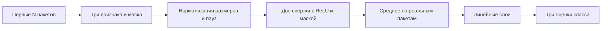

# TrafficClassifier

Учебный проект по раннему распознаванию сетевого трафика. По первым пакетам потока собственная **1D-CNN** определяет один из трёх классов: видео, голосовой звонок или передача файла.

Модель получает размеры пакетов, направления относительно первого пакета и интервалы между соседними пакетами. **ClickHouse** хранит потоки и предсказания и считает объёмы по классам и времени. **PyTorch** обучает нейросеть. Для сравнения **Random Forest** получает сводные признаки по тем же пакетам.

## Результаты

Macro-F1 на 1 993 потоках из отложенных захватов VNAT. Для всех вариантов использовали одно групповое разбиение. Короткие потоки обрабатывали по фактически доступным пакетам.

| Первые N пакетов | 1D-CNN | Random Forest |
|---:|---:|---:|
| 8 | 0,9147 | 0,9751 |
| 16 | 0,8919 | 0,9780 |
| 32 | 0,8889 | 0,9780 |
| 64 | 0,8632 | 0,9780 |

Для пробного окна выбрана CNN на восьми пакетах по оценке на validation. Random Forest показал более высокий macro-F1 на этих отложенных захватах. Все 102 тестовых звонка относятся к одному захвату, поэтому результат отражает условия эксперимента на VNAT.

## Быстрый запуск

Понадобятся Python 3.13 и [uv](https://docs.astral.sh/uv/). Выполни команды из корня репозитория. Вторая команда покажет формы тензоров и выход CNN на искусственных данных.

```powershell
uv sync --locked
uv run --locked -m traffic_classifier.ml.cnn
```

## Данные и обучение

Для подготовки данных нужен Docker с Compose. Скачай `VNAT_Dataframe_release_1.h5` и положи его в `data/`. Нужен релиз с готовыми последовательностями пакетов, размер файла около 1 ГБ. [Датасет VNAT на сайте MIT Lincoln Laboratory](https://www.ll.mit.edu/r-d/datasets/vpnnonvpn-network-application-traffic-dataset-vnat).

Данные VNAT используются локально для обучения и оценки. Сведения о предоставляемых файлах и условия их распространения уточняй у MIT Lincoln Laboratory. [Публикация авторов датасета](https://doi.org/10.1109/TAI.2023.3244168).

Скопируй `.env.example` в `.env` и задай значение `CLICKHOUSE_PASSWORD` в копии. Затем запусти базу и подготовь данные.

```powershell
docker compose up -d --wait
uv run --locked -m traffic_classifier.import_vnat data/VNAT_Dataframe_release_1.h5
uv run --locked -m traffic_classifier.ml.vnat_split
uv run --locked -m traffic_classifier.ml.dataset
uv run --locked -m traffic_classifier.ml.normalization
```

На свежем клоне обучи обе модели и зафиксируй выбор по validation. Команда `freeze` сама создаст локальный файл протокола `docs/prefix-study-protocol.json`.

```powershell
uv run --locked -m traffic_classifier.ml.prefix_study
uv run --locked -m traffic_classifier.ml.forest_study
uv run --locked -m traffic_classifier.ml.final_evaluation freeze
```

Чтобы воспроизвести итоговую оценку на test и построить график, запусти следующие команды. Отчёт, предсказания и график сохраняются в `artifacts/prefix-study-v1/`.

```powershell
uv run --locked -m traffic_classifier.ml.final_evaluation test
uv run --locked -m traffic_classifier.ml.study_plot
```

## Запуск фронтенда

Понадобится Node.js 24. Запусти FastAPI по инструкции ниже в первом терминале. Во втором терминале выполни из корня репозитория.

```powershell
cd frontend
npm.cmd ci
npm.cmd run dev
```

Открой адрес, который напечатает Vite, обычно [http://127.0.0.1:5173](http://127.0.0.1:5173). Vite отправляет запросы к FastAPI на порт 8000. Если запускаешь API на другом порту, перед `npm.cmd run dev` задай его в этом же терминале, например `$env:TRAFFICCLASSIFIER_API_URL = "http://127.0.0.1:8001"`.

Для первого прогноза нужна сохранённая модель из шага `freeze`. В браузере нажми **«Загрузить пример» → «Распознать»**. Справа появятся категория, оценки классов, версия модели и число пакетов, использованных в её окне. Для пробы измени время, размер или направление и распознай поток снова. ClickHouse и Docker для распознавания в браузере не требуются.

Чтобы обновить типы TypeScript после изменения схемы `/openapi.json`, запусти FastAPI и выполни в `frontend/` команду `npm.cmd run api:types -- http://127.0.0.1:8000/openapi.json`. Для другого порта укажи его в адресе.

## Пробное окно

После подготовки модели окно запускается с сохранёнными весами и примерами из validation. Для интерфейса нужен Python с Tkinter. На уже подготовленном проекте достаточно одной команды.

```powershell
uv run --locked -m traffic_classifier.preview
```

Выбери готовый пример или измени размер, время и направление пакета в редакторе и нажми **«Распознать»**. Окно показывает класс и три оценки модели. Его можно запускать с выключенным Docker.

## Локальный API и отчёт

Когда готова модель из шага `freeze`, запусти API из корня проекта.

```powershell
uv run --locked uvicorn traffic_classifier.api.app:app --host 127.0.0.1 --port 8000
```

Открой [http://127.0.0.1:8000](http://127.0.0.1:8000). Главный адрес автоматически перенаправляет в [Swagger](http://127.0.0.1:8000/docs). `GET /ready` показывает выбранную модель, а `POST /api/v1/predict` принимает три массива одной длины. Пример запроса:

```json
{
  "offsets_us": [0, 2000, 5250],
  "sizes_bytes": [100, 300, 180],
  "directions": [1, 0, 1]
}
```

Для отчёта запусти ClickHouse, выполни пакетное распознавание и открой HTML. Повтор команды с теми же данными, моделью и лимитом использует прежний запуск.

```powershell
uv run --locked -m traffic_classifier.batch_predictions --limit 256
uv run --locked -m traffic_classifier.prediction_report
Start-Process .\artifacts\prediction-report.html
```

`GET /api/v1/statistics` возвращает ту же сводку. API и команда отчёта позволяют выбрать запуск, модель и длину префикса. По умолчанию показывается последний завершённый запуск. График объёмов учитывает байты **полных** исторических потоков.

## Архитектура нейросети



## Код и тесты

- [Архитектура CNN](traffic_classifier/ml/cnn.py) и [цикл обучения](traffic_classifier/ml/training.py).
- [Схема и аналитические запросы ClickHouse](sql/).
- [Тесты](tests/) и [проверки GitHub Actions](.github/workflows/checks.yml).

```powershell
uv run --locked pytest -q -m "not clickhouse"
```
